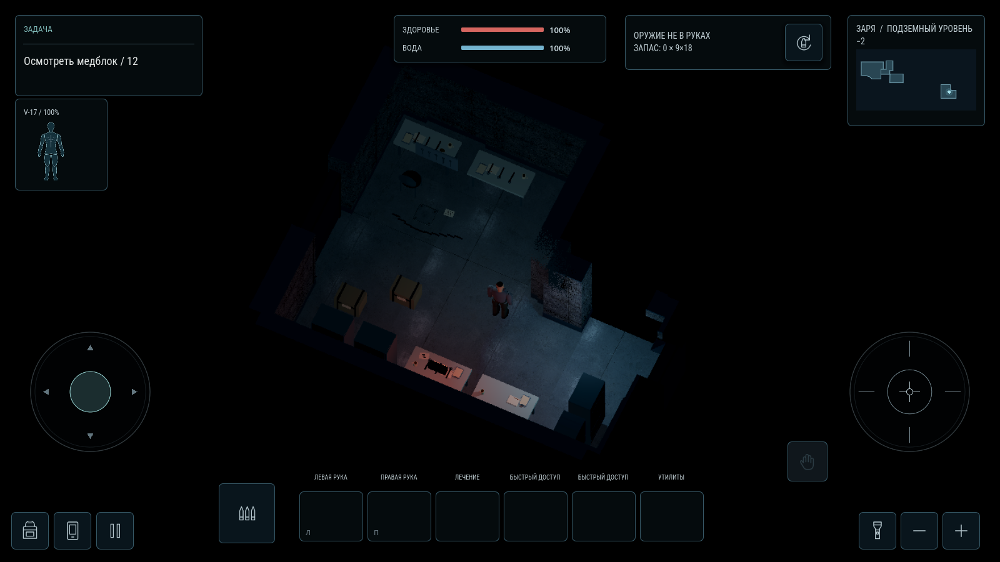
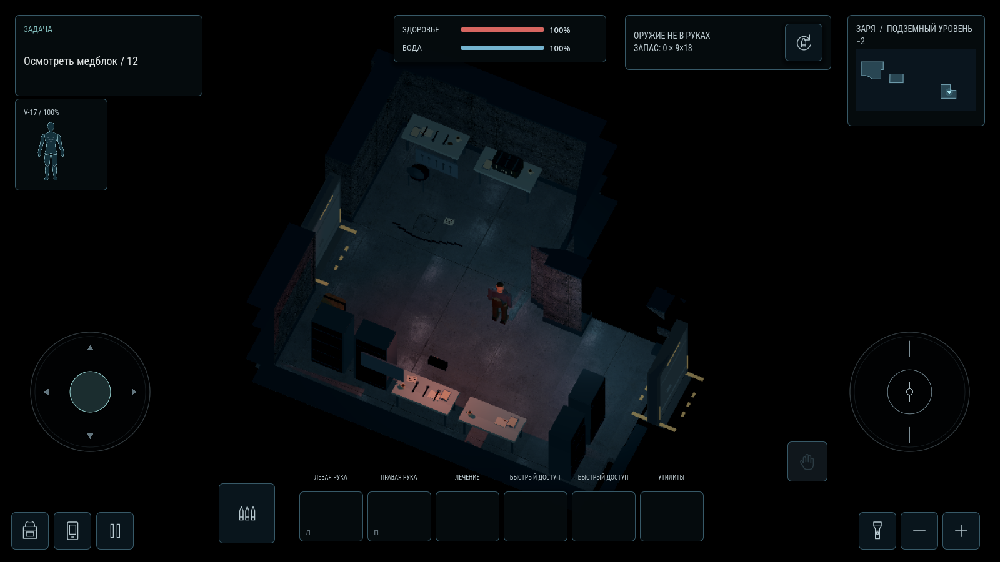
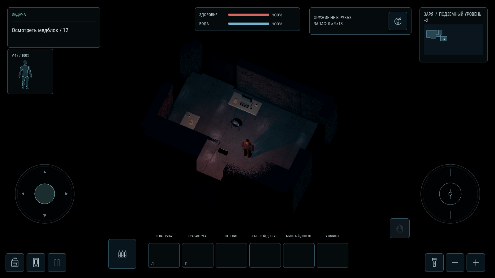
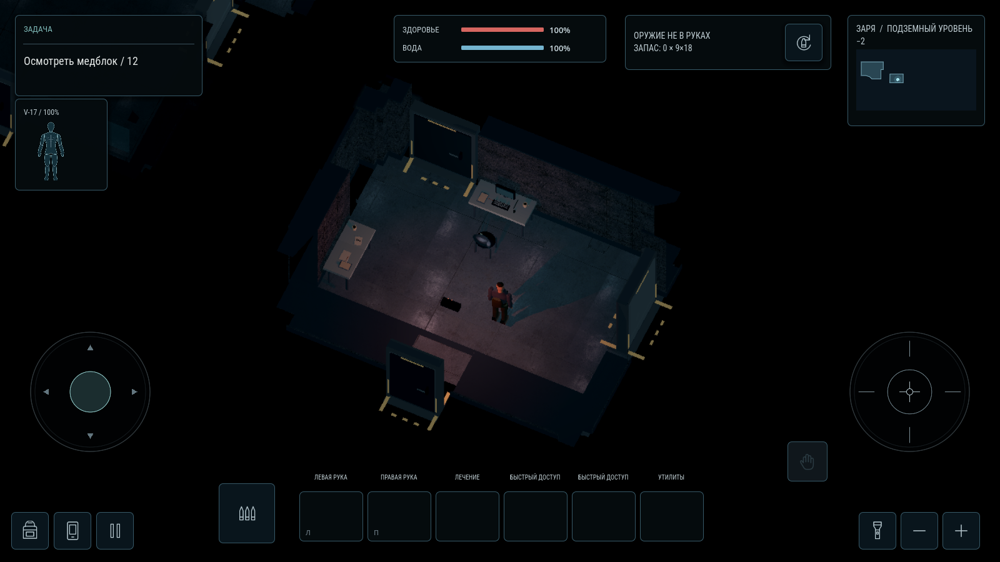
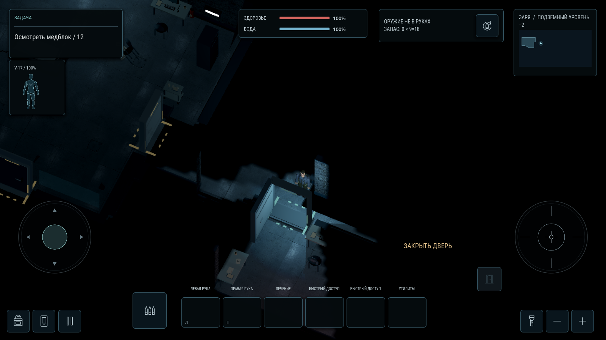
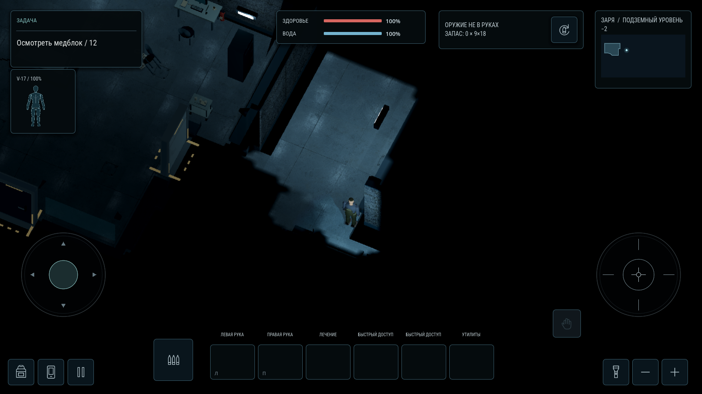
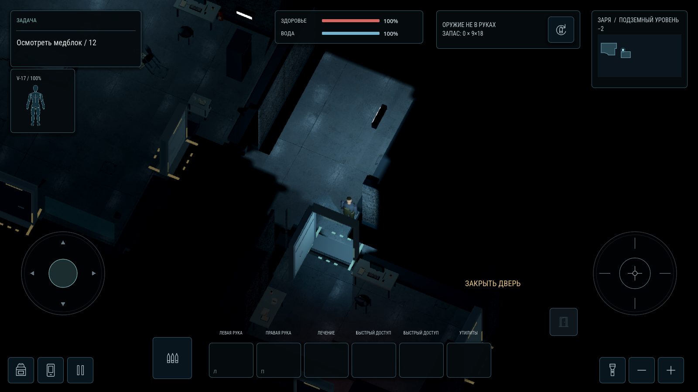
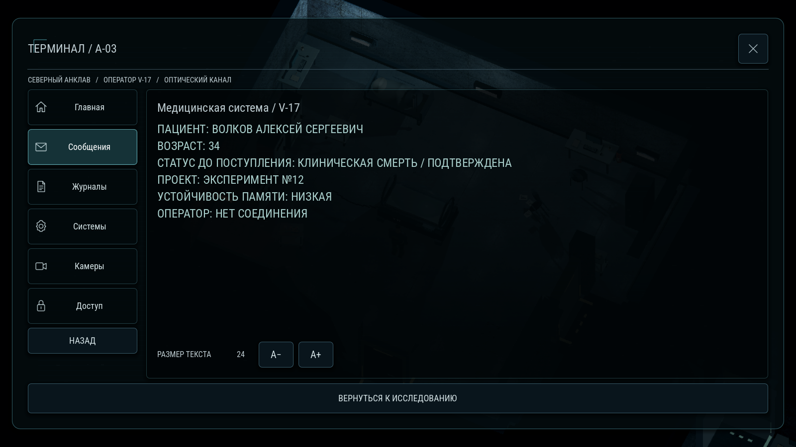
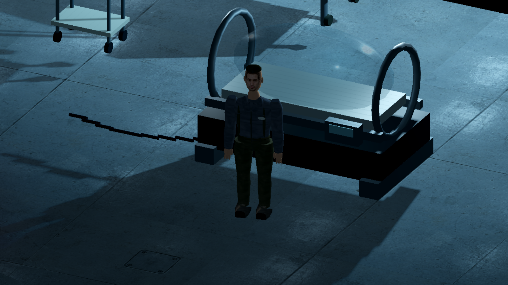
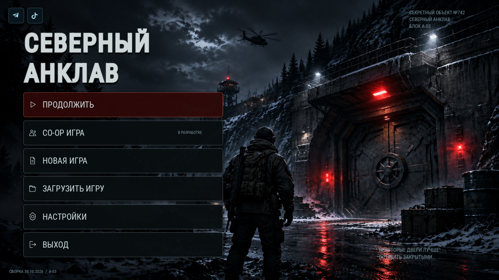

# Завершение прохода по бункеру — 30.10.2026

Вместо исчезающей при каждом переходе комнаты работает физическое поле зрения Волкова. Закрытые двери и стены перекрывают обзор, стекло допускает взгляд и сохраняет коллизию. В непосещённую комнату можно заглянуть через открытый проём; после поворота она скрывается. После полного входа её интерьер остаётся доступным в памяти, с более приглушённым освещением. Коридорные участки больше не переключают весь экран как отдельные пустые комнаты.

## Что изменено

- Поле зрения: сектор 156°, дальность 13 м, ближнее восприятие вокруг персонажа, физические лучи и маска видимости. В экономном профиле частота и число лучей ниже. Враги используют текущую видимость, а не память интерьера.
- Стены: 332 связанных прямых участка в прежней геометрии. Мешающие целые участки плавно становятся прозрачными; верх и боковины используют одну маску. Сохраняется нижний контур и отдельная непрозрачная тень. Круглые зернистые и квадратные вырезы удалены. Стены по краям запомненной комнаты не исчезают из-за границы маски.
- Проёмы: читаемые рамы, полотна, ручки и маркировка порогов. Зазоры у закрытого полотна дополнительно перекрыты для лучей зрения; эти перекрытия не участвуют в движении игрока. Основания соединительных вставок и порогов выровнены с полом.
- Мебель: 18 рабочих мест придвинуты к реальным стенам с небольшим зазором. Соответствующие кресла и физические привязки записок следуют за ними. Островные столы сохраняют назначение. Центр мастерской освобождён; кейс Серова установлен на северном верстаке.
- Ящики: четыре формы и размера — деревянная тара, металлический контейнер, тара под тканевым чехлом и инструментальный кейс. Добавлены фаски, крепления, ручки, застёжки и новые материалы. Груз сгруппирован на поддонах; объекты используют прежние общие пакеты геометрии.
- Камера немного опущена: 61° вместо 65°. Свет нескольких доступных помещений работает в пределах прежнего бюджета теней: 0 / 1 / 2 для трёх профилей. Дополнительных ламп на каждой двери не создано.
- Терминал: прозрачная панель с нативными вкладками и тонкими рамками вместо большой растянутой картинки. Под ней видна сама игра. Сообщения, журналы, состояние систем, контроль доступа и изменение размера текста работают.
- Меню: кнопки крупнее, размещение рассчитывается по всему доступному экрану, без центрирования внутри фиксированной рамки. Зимний фон заполняет окно; кооп остаётся вторым. Отдельный запуск сцены и обычный запуск проекта сохранены.
- Волков: новая текстура лица на объёмной голове, материалы кожи/одежды/обуви, воротник, ремни и рюкзак, более плавные поверхности. Темп походки связан с движением, стопы сохраняют опору, корпус реагирует на поворот. Сохранены пробуждение, прицеливание, перезарядка, стрельба, лечение и ремонт.
- Прохождение: после оружия журнал явно объясняет роль плавкой вставки. Порядок: кейс Серова → K-2 в электрощитовой → резервный клапан в насосной → грузовой шлюз. Записки остаются дополнительным исследованием. У готового шлюза можно завершить бункер, сохранить результат, вернуться в меню или продолжить осмотр.

Новые уровни и открытый мир не добавлены. Вторая кампания не менялась. Выход завершает существующий бункер; экрана с готовой поверхностью пока нет.

## Проверки

11 наборов завершились успешно на Godot 4.7. Подробные результаты находятся в [JSON отчёте](validation/bunker_finish_2026_10_30.json). Проверены загрузка с нуля, F6, новая игра, пролог, продолжение, отмена перезапуска, несколько размеров экрана, лечение через силуэт, записки, вкладки терминала, все двери, текущая видимость, память комнат, тени трёх профилей, старое сохранение внутри перемещённой мебели, сворачивание и восстановление.

Отдельный поиск пути проверил не абстрактную схему: каждый шаг на сетке 0,32 м проверяется движением настоящей капсулы игрока и наличием пола. Найдены пути от спавна к медицинскому ПК, кейсу, реле, насосу и выходу через 6316 доступных ячеек. Локальная проверка дверей дала 48 свободных проходов с обеих сторон, без неожиданных препятствий.

В нескольких ускоренных headless-прогонах при немедленной остановке оставались предупреждения об AudioStreamWAV/AudioStreamPlaybackWAV. Диагностический verbose-прогон показал именно аудиообъекты; в кадровом прогоне после закрытия сцен предупреждение не воспроизвелось. Это не измерение памяти или FPS телефона.

Физический Android не проверялся. Кадры ниже сняты в Godot 4.7 через OpenGL Compatibility с программным рендерером. Входные координаты камеры для крупного плана Волкова используются только инструментом проверки, основной игровой ракурс остаётся 61°.

## Настоящие кадры

Все изображения — рендер проекта, не концепты. Изображения обзора исключены из импорта ресурсов игры.

| До | После |
|---|---|
|  |  |
|  |  |

Взгляд в непосещённую комнату:

Поворот до входа:

Возвращение после входа:

## Установка и материалы

Полный ZIP из ветки PR распаковать в отдельную папку и открыть находящийся в ней project.godot в Godot 4.7. Локальные файлы настроек и сохранения в архив не включаются. Для запуска не нужны Python или инструменты из tools/review: геометрия стен уже подготовлена.

План всех замечаний: [BUNKER_FINISH_PLAN_RU.md](BUNKER_FINISH_PLAN_RU.md). Новые растровые материалы и точные промпты ImageGen: [ART_MATERIALS_2026_10_30_RU.md](ART_MATERIALS_2026_10_30_RU.md).
