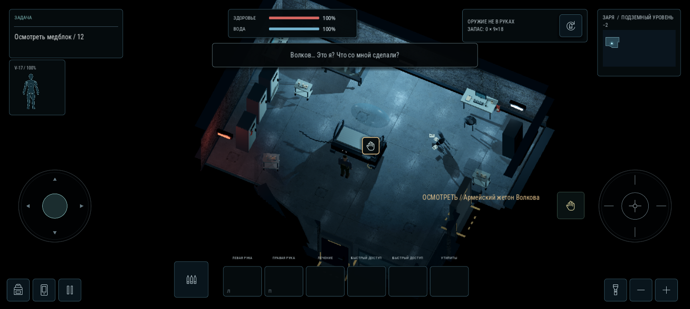
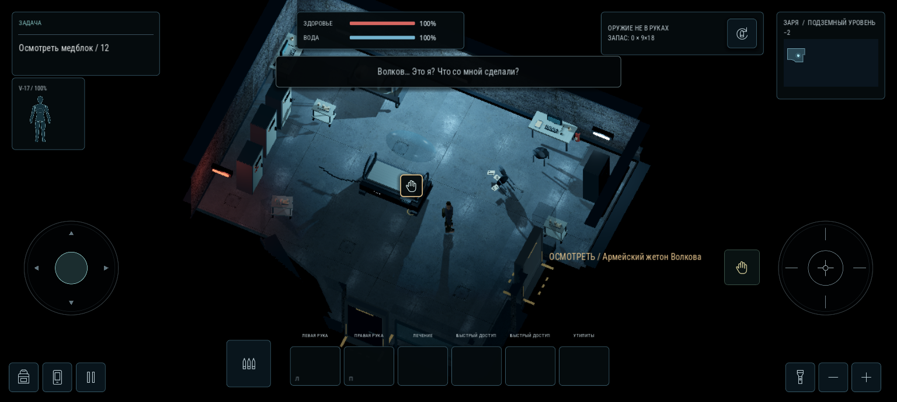
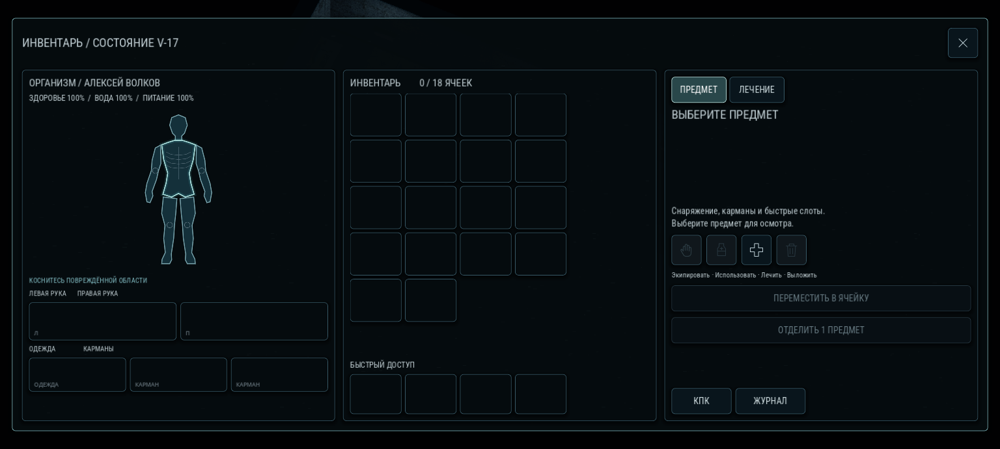

# Исправление капсулы и отображения бункера — A-03.1

Основа — main после PR №13 (`b125a6e`). Повод: на телефоне осталась задача «Открыть глаза», персонаж не управлялся, помещение выглядело пустым. Предыдущие локальные проверки не подтвердили исправность этой сборки на телефоне. Этот проход сохраняет планировку, мебель и коллизии; другие локации не разрабатываются.

## Что исправлено

- **Пробуждение.** Удалена цепочка ожиданий Tween/Timer, которая при прерывании анимации могла навсегда оставить `locked=true`. Пробуждение теперь продвигается по времени кадра, учитывает реальные открытые окна и заканчивается в проверенной точке рядом с капсулой. Закрытый колпак не появляется вновь при загрузке уже проснувшегося персонажа.
- **Восстановление.** Начало выхода сохраняется на диск. Продолжение прерванного выхода не сбрасывает вещи, записи и состояние персонажа. Если окно вступления потеряно, остаются видимая кнопка «Открыть капсулу», кнопка взаимодействия и действие по задаче. Повторное касание позволяет сразу встать. Удалённое окно корректно освобождает паузу и затемнение.
- **Мебель.** Сохранены все 145 записей авторской расстановки, их координаты, формы и коллизии. В комнате с капсулой видны кровать, ПК, шкафы, тележки, стулья и следы происшествия. Мебель посещённых комнат использует обычные непрозрачные материалы Godot: её отображение больше не зависит от пофрагментной маски открытия комнат. Для предварительного взгляда через дверь маска сохраняется.
- **Стены.** Геометрия WallMesh/SkirtMesh/CapMesh совпадает с исходной по вершинам каждого треугольника. Выбор мешающих стен проверяет весь контур текущей комнаты, включая вогнутые углы. Проверка только относительно центра комнаты оставляла непрозрачные выступы перед мебелью. Короткие торцы учитывают скрытие примыкающего участка. Статическая карта участков согласует длинные треугольники верхних граней с боковинами. Задние стены остаются непрозрачными, у скрываемых сохраняются нижний контур и прозрачный силуэт.
- **Отрисовка и свет.** Координаты для маски и текстур переводятся в локальные ещё до интерполяции, без вычитания больших мировых значений во фрагменте. Скрываемые высокие стены оставляют контактную тень у пола; мебель и персонаж сохраняют полные тени. Прозрачный колпак не отбрасывает непрозрачную тень.
- **Управление.** Игровой HUD увеличен на 10%. Взаимодействие поднято примерно на 100 логических пикселей и увеличено до 72×72. Блоки здоровья и оружия разнесены. Инвентарь, терминалы и записки сохраняют прежний масштаб и рабочие действия.
- **Идентификация.** Внизу главного меню указана сборка `A-03.1`, чтобы отличать её от предыдущего архива.

## Проверка и пределы

Все 12 наборов завершились успешно, без ошибок скриптов. Результаты итогового прогона — [JSON](validation/capsule_recovery_2026_10_30.json). Новая проверка капсулы содержит 97 проверок: настоящее нажатие GUI, события касания, уничтожение анимации, потерянное окно, пауза поверх пробуждения, запись при сворачивании, загрузка с диска, низкая частота кадров и движение после выхода. Отдельно проверены сохранность мебели и стен, масштабы интерфейса, поле зрения, все внутренние двери, сюжетные действия и достижимость грузового шлюза.

В нескольких старых ускоренных сценариях осталось предупреждение ObjectDB об объектах при завершении прогона. В новом сценарии капсулы и кадровом первом запуске его нет. Это не проверка памяти на физическом устройстве.

Настоящий первый запуск через меню и три шага вступления снят в Godot 4.7 с OpenGL ES 3.0. Состояние `awake` в этом прогоне не подменяется: персонаж выходит сам и затем двигается сенсорным джойстиком. Кадры — рендер игры, не концепты.

**Физический Android и FPS устройства не проверены.** Точная причина исчезновения мебели на конкретном телефоне локально не воспроизведена: до исправления в программном GLES она отображалась. Новая схема убирает зависимость мебели открытой комнаты от сложной маски, но это не заменяет проверку на самом устройстве.

## Установка

Полный архив распаковать в отдельную папку и импортировать её `project.godot` в Godot 4.7. В меню должна быть отметка `A-03.1`. Сохранение не удалять: продолжение старого зависшего выхода предусмотрено. Python и инструменты проверки для игры не нужны; карта участков стен уже подготовлена. Кэш редактора, локальные сохранения, токены и служебные журналы в архив не включаются.
