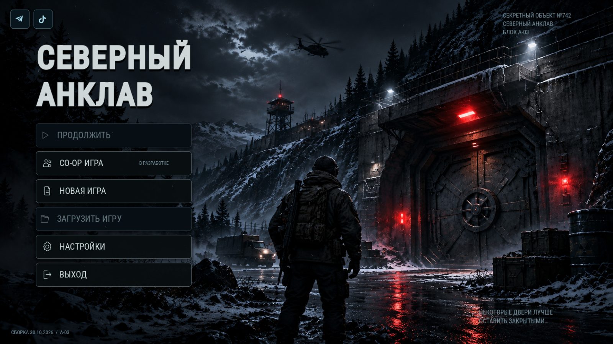

# Исправление сцены главного меню

30 октября 2026 года.

В `scenes/ui/MainMenu.tscn` оставалась разметка старого меню: «Играть», запечатанная военная кампания, пояснение про ЭМИ-удар и подпись сборки 2.1. Новый контроллер заменял эти узлы при запуске, поэтому исходная сцена по-прежнему содержала старый экран. По одному скриншоту нельзя установить, была ли открыта старая копия проекта, предпросмотр сцены или приложение со старым кодом.

Теперь старые узлы удалены из самой сцены. Фон зимнего бункера, заголовок, шесть кнопок слева, ссылки на соцсети и оформление сохранены как обычные узлы Godot. Их видно в редакторе без выполнения скрипта. Контроллер подключает действия, состояние сохранения, музыку и снег. Отдельного построителя другой разметки больше нет.

При запуске сцены меню отдельно (F6) она передаёт управление основному контроллеру игры, чтобы кнопки могли запускать прохождение. Обычный запуск через `project.godot` и возврат из игры используют ту же сцену. Фон заполняет весь экран, включая широкие форматы телефона. CO-OP сохранён вторым пунктом.

В нижнем левом углу указано `СБОРКА 30.10.2026 / A-03` для проверки открытой версии.

## Проверка

- Чистый импорт и обычный запуск на Godot 4.5.1 и Godot 4.7.
- Новый набор из 106 проверок: готовая разметка при отключённом контроллере, обычный старт, запуск сцены отдельно, новая игра, возврат в меню и четыре размера окна.
- Прежний сквозной сценарий из 23 проверок также прошёл на обеих версиях движка.
- Настоящие кадры получены в Godot 4.7 / OpenGL Compatibility: обычный запуск проекта, отдельный запуск меню и статический предпросмотр. Это не макет.
- Физический Android не проверялся.

## Установка

Скачайте полный ZIP этого обновления, распакуйте в отдельную папку и откройте находящийся в ней `project.godot`. Старую папку с сохранениями удалять не требуется. Предыдущие изменения инвентаря, терминалов, записок, скорости и теней включены. Локации и вторая кампания этим исправлением не менялись.
