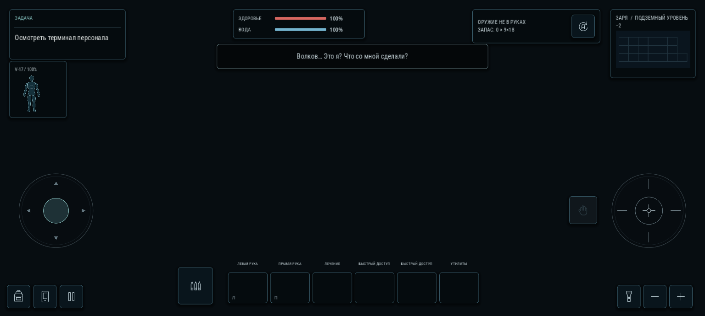
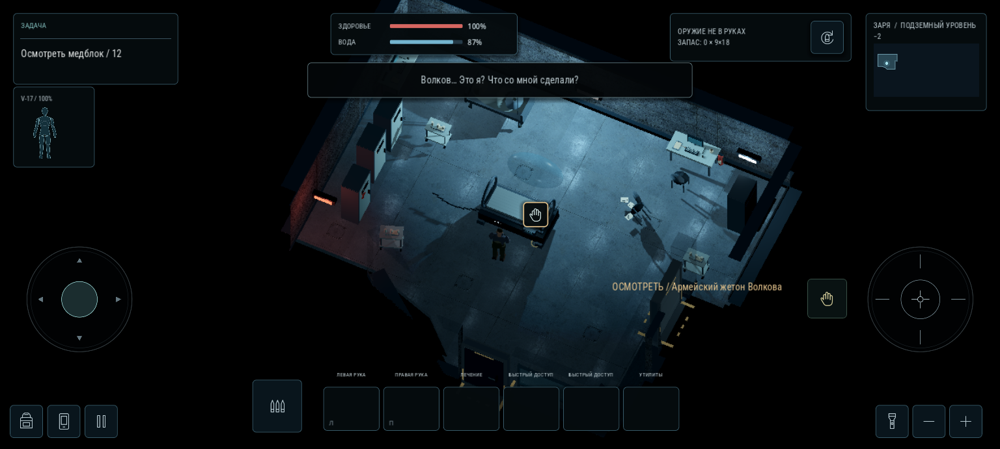
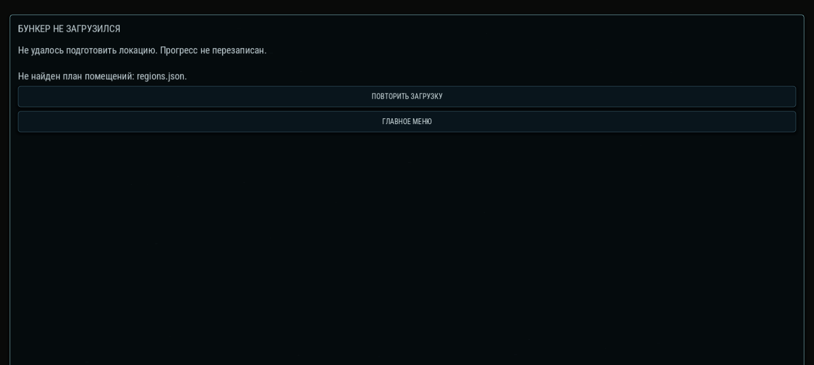

# A-03.2 — чёрный экран и неработающее управление

База: main после PR №14, `36f912e`. На снимке с телефона HUD работал, но локации не было. Задача «Осмотреть терминал персонала» и прямоугольная сетка миникарты относились к старой схеме, а кнопка капсулы — к новому HUD. Это признаки незавершённой сборки сцены, а не тумана или удаления мебели.

## Что удалось воспроизвести

В копии A-03.1 удалены только `wall_section_ids.png` и его метаданные импорта. Жёсткий preload в runtime.gd перестал компилироваться. Остальной контроллер продолжал работу: `custom_layout=false`, `rooms=0`, `state_key=zarya2`, прежняя задача и пустой мир. Отдельно создаваемый HUD оставался доступным. По нажатию выхода пробуждение могло продолжать работу без настоящей капсулы и корректной точки выхода.

Именно такой вид экрана воспроизведён локально. Доступа к журналу конкретного телефона нет: отсутствие или непрочитанный ресурс на нём остаётся предположением, а сам дефект загрузки подтверждён.

## Исправление

- Маска стен загружается как необязательная текстура. Если она отсутствует, используются уже записанные в меши идентификаторы участков; комнаты, мебель, свет и коллизии продолжают строиться. Новых стен или локаций нет.
- Контроллер сразу использует состояние `zarya_layout3`. Старый запасной план больше не маскирует ошибку нового бункера.
- `startup_ready` выставляется после создания капсулы, помещений, обстановки и видимости. До этого нельзя двигаться, завершать пробуждение или сохранять положение персонажа.
- При существенном сбое откатываются изменения незавершённой сборки. Вещи, записи, раны и позиция реального сохранения не перезаписываются. Вместо пустого мира показываются причина, «Повторить загрузку» и «Главное меню».
- Повторная загрузка читает текущий скрипт сборки. Вызов помощника теней совместим с прежней версией с одним аргументом. Материалы мебели не требуют нового метода от старого закэшированного производителя; отсутствующее старое значение surface_tile допускается.
- JSON явно включён в экспорт. Инструменты проверки и циклический редакторский Location_Example.tscn исключены из игрового пакета. Android-пакет данных экспортирован и запущен отдельно, без обращения к исходным ресурсам проекта.
- В меню указана версия `A-03.2`.

## Проверки

Пять изолированных сценариев прошли на Godot 4.6 и 4.7: полный проект; отсутствующая маска стен; старый помощник теней; старый производитель мебели; отсутствующий план комнат с выходом в меню и повторной загрузкой после восстановления файла. В каждом успешном запуске проверяются 33 области, 25 дверей, 145 авторских предметов, реальное касание кнопки капсулы, движение джойстиком, взаимодействие с терминалом и инвентарь. В сценарии ошибки проверяется неизменность состояния и сохранения на диске.

Дополнительно прошли прежние 12 наборов регрессий Godot 4.7, включая 97 проверок капсулы, 48 проходов дверей и пути к обязательным сюжетным узлам. Результаты — [JSON](validation/startup_repair_2026_10_30.json). Проверки с отсутствующими файлами работают в отдельной временной копии и не меняют рабочий проект. Сам архив замен установлен поверх A-03.1 с удалённой маской; повторно проверены загрузка, выход из капсулы, касания, терминал и инвентарь.

Кадры получены в Godot 4.7 / OpenGL ES 3.0 с программным рендерером. Физический Android и его частота кадров не проверены.

## Настоящие кадры

До исправления, контролируемое отсутствие одного ресурса:

После исправления, тот же ресурс по-прежнему отсутствует:

Отдельный сценарий с отсутствующим обязательным планом; обе кнопки проверены касаниями, после возврата файла выполнена успешная повторная загрузка:

## Установка

Полностью закрыть запущенную игру и Godot перед заменой файлов. Полный архив распаковывается в отдельную папку и открывается через находящийся в ней project.godot. Если используется архив замен, его содержимое копируется в корень существующего проекта с сохранением папок. Затем заново открыть проект; в меню должна быть версия `A-03.2`.

Сохранение не удалять и новую кампанию для восстановления не создавать. Нажать «Продолжить». Слияние PR остаётся владельцу.
